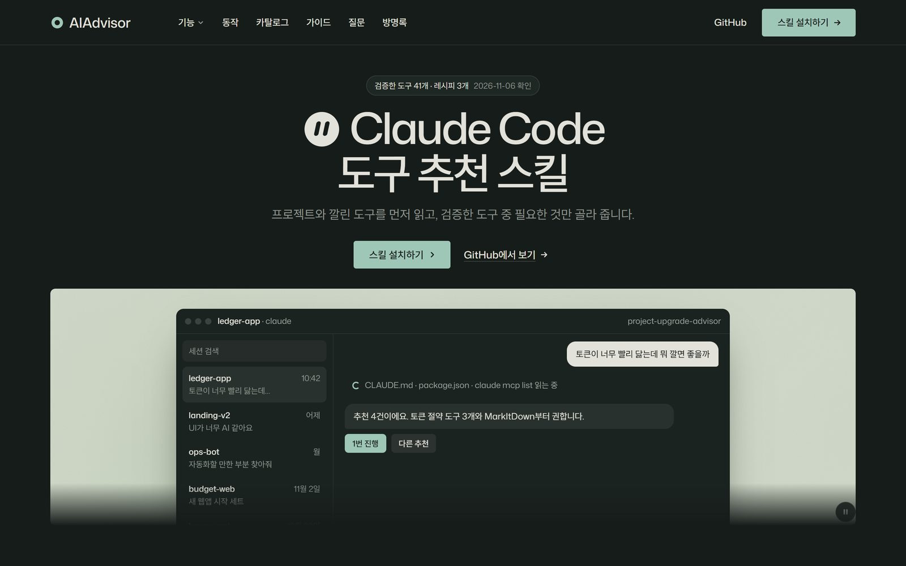
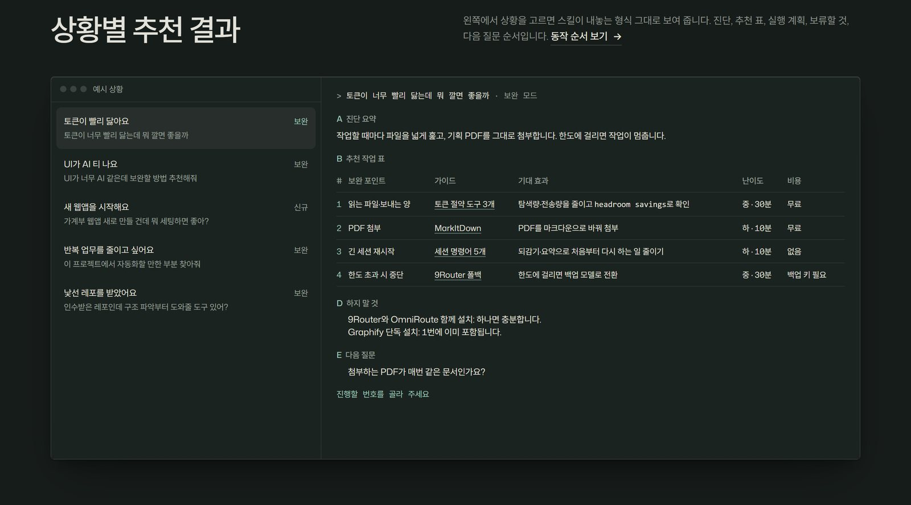
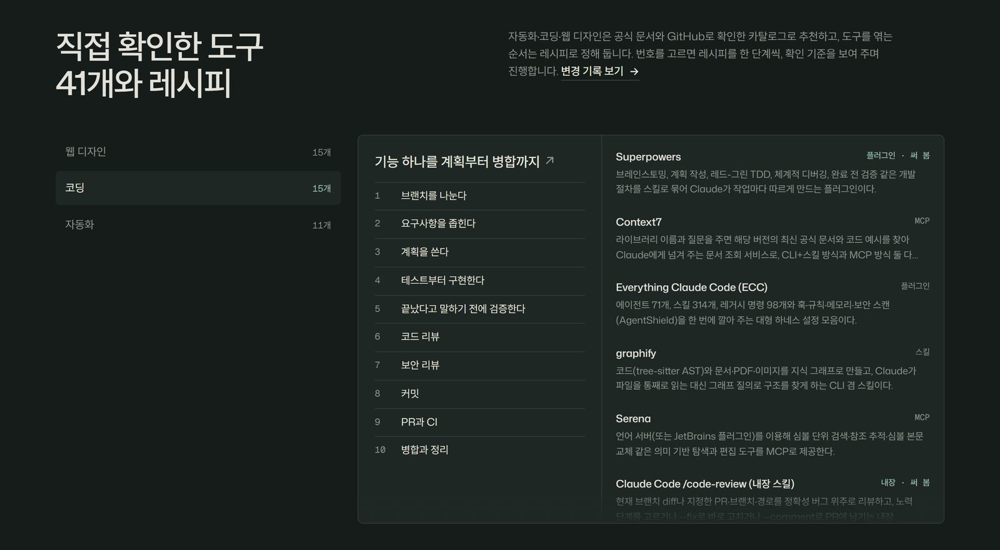

<h1 align="center">AIAdvisor</h1>

<p align="center">프로젝트를 먼저 읽고, 지금 깔 만한 Claude Code 도구만 골라 주는 스킬</p>

<p align="center">
  <a href="https://devvshyun.github.io/AIAdvisor/"></a>
  
  <a href="https://github.com/devvshyun/AIAdvisor/actions/workflows/pages.yml"></a>
  
</p>

<p align="center">
  <a href="https://devvshyun.github.io/AIAdvisor/"></a>
</p>

## 바로 써 보기

```bash
git clone https://github.com/devvshyun/AIAdvisor.git ~/.claude/skills/project-upgrade-advisor
```

Claude Code를 새로 열고 프로젝트 폴더에서 이렇게 물어보세요.

```
> 프로젝트에서 보완할 부분 추천해줘
```

Windows PowerShell이나 클라우드 세션은 [설치](#설치)를 보세요.

## 왜 만들었나

스킬과 MCP는 매주 쏟아지는데, 대부분은 내 프로젝트에 필요 없습니다. 추천 글은 한 달이면 낡고, 비슷한 도구 두 개를 같이 깔면 서로 지시가 부딪칩니다. 그래서 도구를 고르기 전에 프로젝트부터 읽는 스킬을 만들었습니다.

AIAdvisor는 CLAUDE.md, 의존성 파일, git log, 이미 깔린 MCP와 스킬, 플러그인을 읽고 나서 추천합니다. 이미 있는 건 빼고, 역할이 겹치면 하나만 남깁니다. 번호를 고르기 전까지는 아무것도 설치하지 않습니다.

## 이렇게 답합니다

```
> 토큰이 너무 빨리 닳는데 뭐 깔면 좋을까
```



답은 늘 같은 순서입니다. 진단 → 추천 표 → 상위 3개 실행 계획 → 하지 말 것 → 다음 질문. 명령은 지금 OS에 맞춰 바꿔 줍니다. [데모 페이지](https://devvshyun.github.io/AIAdvisor/#demo)에서 다른 상황 다섯 가지를 눌러 볼 수 있습니다.

번호를 고르면 그때부터 한 단계씩 진행합니다. 설치가 필요한 단계는 명령과 위험을 먼저 보여 주고 허락을 받습니다. 단계가 끝날 때마다 확인한 결과를 보여 주고 다음으로 갈지 묻습니다.

## 이렇게 물어보세요

| 상황 | 말 |
|---|---|
| 토큰이 빨리 바닥남 | "토큰이 너무 빨리 닳는데 뭐 깔면 좋을까" |
| 화면이 AI가 만든 티가 남 | "UI가 너무 AI 같은데 보완할 방법 추천해줘" |
| 배포·점검을 손으로 하고 있음 | "배포랑 링크 점검 자동으로 돌게 하고 싶어" |
| 남의 레포를 넘겨받음 | "인수받은 레포인데 구조 파악부터 도와줄 도구 있어?" |
| 새 프로젝트를 시작함 | "가계부 웹앱 새로 만들 건데 뭐 세팅하면 좋아?" |
| 추천 근거를 새로 고치고 싶음 | "카탈로그 갱신해줘" |

빈 폴더나 아이디어만 있으면 신규 모드로 바뀌어서 시작 도구 세트와 첫 주 계획을 짭니다. `/project-upgrade-advisor`로 직접 불러도 됩니다.

## 무엇을 근거로 추천하나

자동화·코딩·웹 디자인은 공식 문서와 GitHub 저장소를 하나씩 열어 보고 만든 **도구 카탈로그**를 씁니다. 항목마다 설치 명령과 확인 방법, 비용, 겹치는 도구, 위험(권한, 외부로 나가는 데이터), 관리 상태, 확인한 날짜를 적었습니다. 관리가 멈춘 도구는 추천하지 않고, 확인한 지 30일이 넘은 항목에는 바뀌었을 수 있다고 표시합니다.

도구를 엮는 순서는 **레시피**로 정해 두었습니다. 이 저장소를 만들면서 실제로 그 순서대로 해 봤고, 막혔던 일은 레시피의 "써 보니"에 적었습니다.

| 분야 | 카탈로그 | 레시피 |
|---|---|---|
| 웹 디자인 | [15개](references/catalog/web-design.yaml) | [웹 화면 디자인: 생성 스킬은 하나만](references/recipes/web-design.md) |
| 코딩 | [19개](references/catalog/coding.yaml) | [기능 하나를 계획부터 병합까지](references/recipes/coding.md) |
| 자동화 | [12개](references/catalog/automation.yaml) | [배포·월간 점검, 매주 리뷰하는 Claude](references/recipes/automation.md) |



매달 1일 GitHub Actions가 카탈로그에 있는 저장소들이 보관되거나 멈췄는지 확인하고, 문제가 있으면 이슈를 엽니다. "카탈로그 갱신해줘"라고 하면 그날을 기준으로 다시 조사합니다([절차](references/catalog/REFRESH.md), [변경 기록](references/catalog/CHANGELOG.md)).

<details>
<summary>카탈로그 밖의 주제: 가이드 82편</summary>

영상, 프롬프트, 리서치처럼 카탈로그에 없는 주제는 `references/`의 가이드를 봅니다. 2026-11-05에 정리한 자료라서, 같은 도구가 카탈로그에 있으면 카탈로그를 따릅니다. 전체 목차는 [references/README.md](references/README.md)에 있습니다.

| 주제 | 편수 | 예시 |
|---|---:|---|
| [스킬·MCP](references/01-skills-mcp/) | 12 | 필수 MCP 5개, ECC 에이전트 팀 |
| [영상·이미지](references/02-video-image/) | 14 | Higgsfield 명령어, 모션 그래픽 프롬프트 |
| [자동화](references/03-automation/) | 16 | 메일 답장 위임, n8n 첫 에이전트 |
| [프롬프트](references/04-prompts/) | 8 | 발표 자료 프롬프트, 아첨 줄이는 설정 |
| [코딩](references/05-coding/) | 4 | 세션 명령어 5개, 바이브 코딩 도구 |
| [비용 절약](references/06-cost-saving/) | 11 | 토큰 절약 도구, 모델 폴백, 무료 서버 |
| [공부·리서치](references/07-study-research/) | 5 | NotebookLM 세컨드 브레인 |
| [비즈니스](references/08-business/) | 4 | 아이디어 검토 에이전트, 연락처 수집 |
| [웹 디자인](references/09-web-design/) | 4 | AI 티 안 나는 웹사이트, 디자인 스킬 5개 |
| [글쓰기](references/10-writing/) | 2 | AI 표식 지우기 |
| [기타](references/99-etc/) | 2 | 무료 LLM API 연결 |

</details>

## 설치

스킬 폴더 이름이 스킬 이름이 되므로 꼭 `project-upgrade-advisor` 폴더로 받아야 합니다. 받은 뒤에는 Claude Code 세션을 새로 열어야 잡힙니다.

```bash
# macOS · Linux · Git Bash
git clone https://github.com/devvshyun/AIAdvisor.git ~/.claude/skills/project-upgrade-advisor
```

```powershell
# Windows PowerShell
git clone https://github.com/devvshyun/AIAdvisor.git "$env:USERPROFILE\.claude\skills\project-upgrade-advisor"
```

<details>
<summary>클라우드 세션 (claude.ai/code)</summary>

클라우드 환경 설정 스크립트에 넣으면 세션마다 최신 버전을 받습니다. 네트워크 접근에서 GitHub가 허용돼 있어야 합니다.

```bash
git clone --depth 1 https://github.com/devvshyun/AIAdvisor.git ~/.claude/skills/project-upgrade-advisor
```

</details>

<details>
<summary>설치 확인, 업데이트, 삭제</summary>

| 하려는 일 | 명령 |
|---|---|
| 설치 확인 | `ls ~/.claude/skills/project-upgrade-advisor` (SKILL.md가 보이면 됨) |
| 업데이트 | `cd ~/.claude/skills/project-upgrade-advisor && git pull` |
| 삭제 | 폴더를 지우면 끝. 다른 설정은 건드리지 않습니다 |

</details>

## 데모 페이지

[devvshyun.github.io/AIAdvisor](https://devvshyun.github.io/AIAdvisor/)는 처음에 여러 디자인 스킬을 차례로 엮어 만들었습니다. 그 경험으로 웹 디자인 레시피를 "생성 스킬은 하나만" 방식으로 바꿨고, 같은 페이지를 스킬마다 따로 고친 비교는 [showcase/web-generators](showcase/web-generators/README.md)에 있습니다. 페이지 왼쪽 아래 "컨셉" 버튼으로 같은 내용을 레퍼런스 하나씩만 따라 지은 [컨셉 A](https://devvshyun.github.io/AIAdvisor/concept-a/)와 [컨셉 B](https://devvshyun.github.io/AIAdvisor/concept-b/)로 바꿔 볼 수 있습니다. 팔레트와 서체 조합, 히어로 구성은 taste-skill 키트의 스크립트로 뽑았고, 무엇이 나왔는지는 [docs/DESIGN.md](docs/DESIGN.md)에 있습니다. 카탈로그와 가이드 목록은 `scripts/build_demo.py`가 `references/`에서 만들어서, 배포할 때마다 저장소 내용과 맞춰집니다.

```bash
python -m http.server 8000 --directory docs   # http://localhost:8000
```

<details>
<summary>저장소 구조</summary>

```
SKILL.md              스킬 정의: 모드, 진행 순서, 출력 형식, 규칙
references/
  INDEX.md            스킬이 먼저 읽는 색인 (레시피, 카탈로그 id, 가이드 상황별 표)
  catalog/            도구 카탈로그와 형식·갱신 절차·변경 기록
  recipes/            분야별 레시피
  01-skills-mcp/ …    가이드 82편
scripts/
  build_demo.py       INDEX.md와 데모 페이지의 목록 생성 (--check: 어긋남만 확인)
  check_catalog.py    카탈로그 형식 검사, 저장소 관리 상태 확인
evals/                skill-creator 형식의 평가 케이스
.github/workflows/    데모 배포, 월간 카탈로그 점검
docs/                 데모 페이지 (GitHub Pages)
```

</details>

## 라이선스

`docs/assets/`의 키트 파일은 [taste-skill](https://github.com/Leonxlnx/taste-skill)(MIT, © 2026 Leonxlnx)에서 가져왔습니다. 라이선스 전문은 [docs/assets/LICENSE-taste-skill.txt](docs/assets/LICENSE-taste-skill.txt)에 있습니다.
