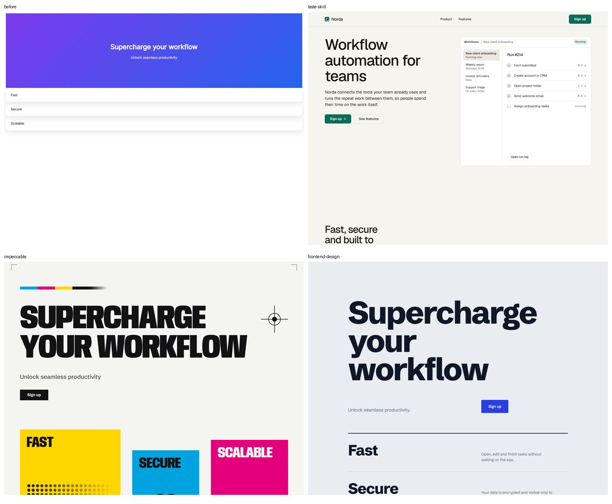
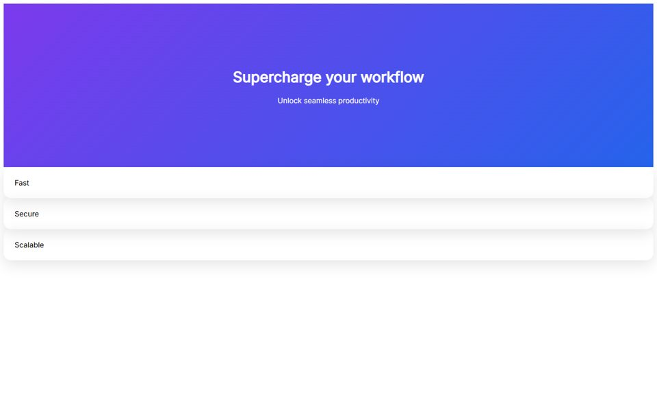
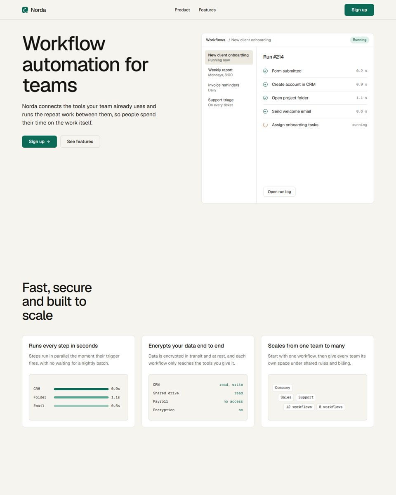
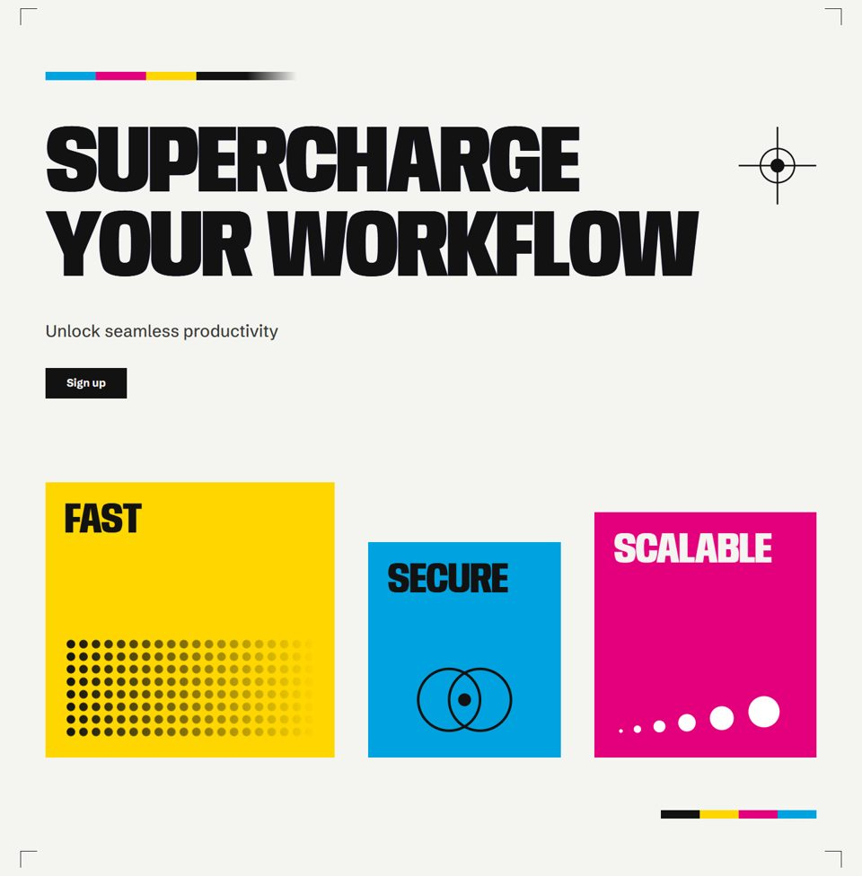
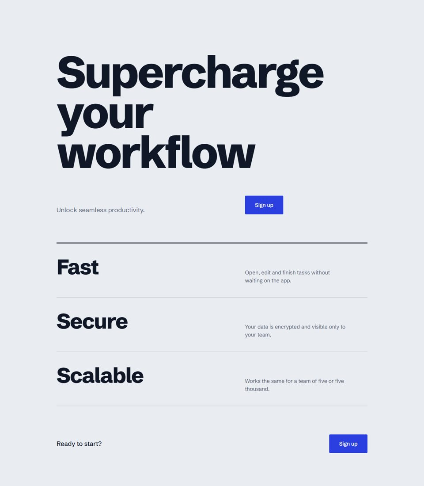
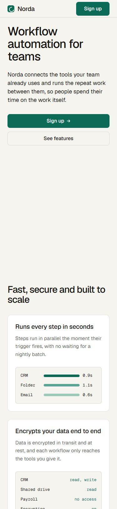
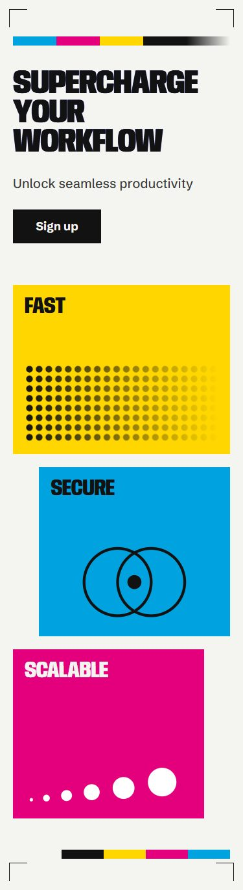

# 생성 스킬 3개 따로 돌려 보기

같은 페이지를 디자인 생성 스킬 세 개에 **각각 따로** 고치게 했다. 실행마다 다른 생성 스킬은 껐다(레시피 `web-design.md` 2단계 방식). 섞지 않으면 결과가 어떻게 다른지, 레시피의 판단표가 맞는지 확인하려는 시험이다.

- 실행한 날: 2026-11-09
- 비포 재료: `showcase/fixtures/web/index.html` (Inter 글꼴, 보라→파랑 그라데이션, 같은 카드 세 장)
- 요청: `showcase/fixtures/prompts.md`의 `web-fix` 그대로, 앞에 "○○ 스킬을 써서 작업해."만 붙였다.
- 실행: `showcase/scripts/measure.py`로 `claude -p` 1회씩. 파일 편집과 `node`·`cp`·`mkdir`·`ls`만 허용했다. 측정 원본은 `showcase/<id>/runs/`.
- 캡처: `showcase/scripts/shot.py`, 1440px와 375px.

## 결과

| | taste-skill | impeccable | frontend-design |
|---|---|---|---|
| 방향 | 차분한 SaaS 제품 소개, 오른쪽에 제품 화면 | 원색 포스터풍, 굵은 대문자 | 큰 활자 편집 디자인, 왼쪽 정렬, 포인트 색 하나 |
| 원래 문구 유지 | **아니오.** 제목과 Fast·Secure·Scalable을 지우고 "Norda"라는 브랜드를 지어냈다. 답변에는 "그대로 두었다"고 적었다 | 예. 문구 경고를 무시 규칙으로 처리하고 그대로 뒀다 | 예. 기능마다 한 줄 설명을 더했다 |
| 같이 만든 파일 | 없음 | `PRODUCT.md`, `DESIGN.md`, `.impeccable/config.json` | 없음 |
| 375px 가로 스크롤 | 없음 | 없음 | 없음 |
| 입력 토큰 | 1,170,954 | 1,547,764 | 144,736 |
| 출력 토큰 | 12,587 | 14,911 | 4,000 |
| 턴 / 시간 | 19턴 / 101초 | 25턴 / 190초 | 5턴 / 36초 |
| 비용(목록가 기준) | $0.53 | $0.73 | $0.14 |

| 비포 | taste-skill | impeccable | frontend-design |
|---|---|---|---|
|  |  |  |  |
| |  |  |  |

## 알게 된 것

- **섞지 않으면 각자 일관된다.** 세 결과는 방향이 완전히 다르지만 각각은 하나의 시스템으로 보인다. 데모 페이지처럼 여러 스킬을 차례로 엮었을 때의 "이상하게 섞인" 결과는 나오지 않았다.
- **스킬의 보고와 결과가 다를 수 있다.** taste-skill은 문구를 유지했다고 답했지만 실제 파일에서는 지웠다. 결과 파일을 직접 확인해야 한다.
- **taste-skill은 이 시험에서 제 실력을 다 내지 못했다.** 키트 파일 복사가 승인을 요구해 막혔고, 뽑기 스크립트 없이 규칙만 손으로 따랐다. 비대화 실행의 권한 설정 한계라 스킬 자체의 문제는 아니다. 키트까지 쓰려면 대화형 세션에서 승인하며 돌린다.
- **비용 차이가 크다.** frontend-design은 지시문만 있어 가볍고(5턴, 약 14만 토큰), impeccable과 taste-skill은 자체 문서와 스크립트를 읽느라 열 배 가까이 썼다.
- **판단표와 맞는다.** "이미 있는 화면을 고친다"에 impeccable을 고르는 판단표대로라면, 문구를 지키고 기준 문서(PRODUCT.md, DESIGN.md)까지 남긴 impeccable이 이 상황에 맞았다. 다만 결과가 매우 강한 포스터풍이라, 차분한 화면이 필요하면 `quieter`로 한 번 더 다듬어야 한다.

## 정리

- 시험용으로 프로젝트 범위에 설치한 frontend-design 플러그인은 지웠다(`claude plugin uninstall frontend-design@claude-plugins-official -s project`).
- 결과 HTML은 저장소에 넣지 않았다. 캡처와 수치만 남긴다.
